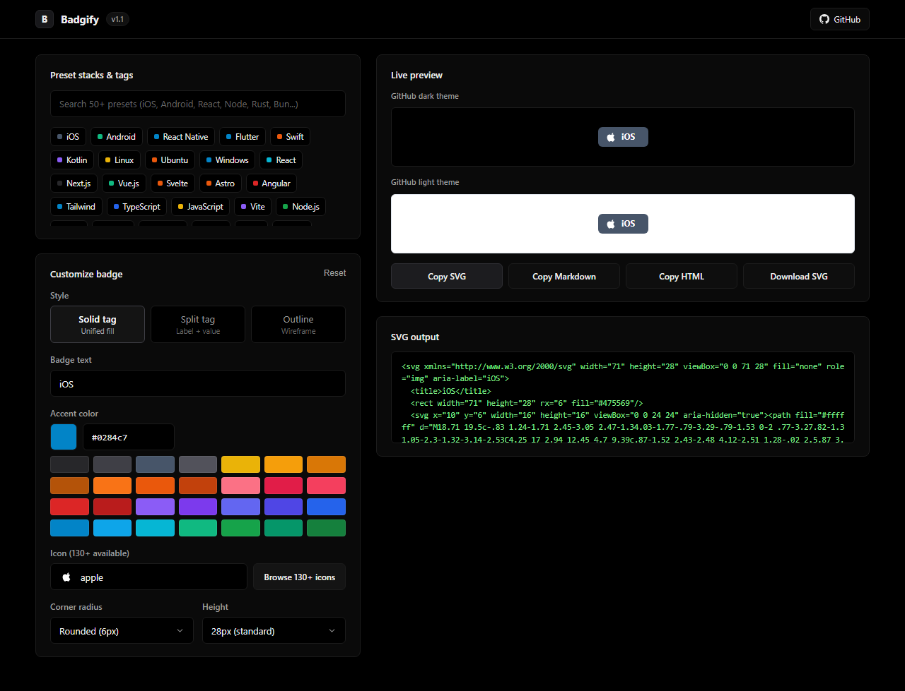

<div align="center">
  <h1>Badgify</h1>
  <p><strong>High-end, aesthetic, minimalistic SVG badge generator for modern developers.</strong></p>
  <p>Zero external network latency. Pixel-perfect geometric optics. Handcrafted typography and palettes.</p>
  <p>
    <a href="https://a-kio.github.io/Badgify/"><strong>Open Live Studio &rarr;</strong></a>
  </p>
  <p>
    <a href="LICENSE"></a>
    
    
    
    
    
    
  </p>
</div>

---

<div align="center">
  
</div>

---

## Why Badgify?

Most badge generators rely on remote servers, introduce image load jitter in GitHub READMEs, or use dated typography with unbalanced visual weight.

**Badgify** generates pure, standalone SVG badges that:
- **Never go down**: 100% vector SVG files committed directly to your repository.
- **Look breathtaking**: Built with optical kerning, balanced padding, and modern rounded/split geometry.
- **Match the developer aesthetic**: Inspired by modern minimalist design systems (Raycast, Linear, Vercel).
- **Fast CLI workflow**: Generate single badges or entire catalogs in milliseconds.

---

## Quickstart

### Run with `npx` (No Install Needed)

```bash
# Generate a solid badge from a preset
npx badgify preset typescript --output badges/typescript.svg

# Generate a split-style badge
npx badgify preset node-split --output badges/node.svg

# Generate a custom badge with custom hex color and label
npx badgify create --value "v2.4.0" --label "release" --color "#38bdf8" --style split --output badges/version.svg
```

### Install Globally or in your Project

```bash
# Using pnpm
pnpm add -D badgify

# Using npm
npm install --save-dev badgify
```

---

## Styles

Badgify supports two signature styles out of the box:

### 1. Solid Badges
Unified color badge with integrated high-contrast typography and monochrome icon.

| Badge | Preview Code |
| :--- | :--- |
| **Rust** | `npx badgify preset rust` |
| **Docker** | `npx badgify preset docker` |
| **Go** | `npx badgify preset go` |
| **Kubernetes** | `npx badgify preset kubernetes` |

### 2. Split Badges
Dark metadata label on the left with a colored value badge on the right.

| Badge | Preview Code |
| :--- | :--- |
| **License (Split)** | `npx badgify preset mit-split` |
| **Node.js (Split)** | `npx badgify preset node-split` |
| **Status (Split)** | `npx badgify preset status-alpha-split` |
| **Privacy (Split)** | `npx badgify preset local-first-split` |

---

## CLI Reference

### 1. `badgify create`
Create fully customized badges on the fly:

```bash
badgify create [options]

Options:
  -v, --value <text>         Primary badge value (e.g. "React Native", "v2.0", "MIT") [required]
  -l, --label <text>         Left-side label for split style (e.g. "license", "node")
  -c, --color <hex>          Accent hex color (e.g. "#38bdf8", "#10b981")
  -s, --style <type>         Badge style: 'solid' | 'split' | 'outline' (default: "solid")
  -i, --icon <nameOrPath>    Icon name (e.g. "react", "node", "typescript")
  -h, --height <number>      Height in pixels (24, 28, 32) (default: 28)
  -r, --radius <typeOrNum>   Corner radius: 'rounded' | 'pill' | 'sharp' (default: "rounded")
  -o, --output <file>        Save SVG directly to file path
```

### 2. `badgify preset <id>`
Quickly output any standard developer stack badge:

```bash
badgify preset typescript -o ./assets/typescript.svg
badgify preset python -o ./assets/python.svg
badgify preset tailwindcss -o ./assets/tailwind.svg
```

### 3. `badgify catalog`
Batch-generate the entire library of 40+ presets (both solid and split versions) into your project's `./badges` directory:

```bash
badgify catalog --dir ./badges
```

### 4. `badgify list`
List all built-in presets categorized by ecosystem:

```bash
badgify list
```

Available categories include:
- **Frontend & Mobile**: `react`, `react-native`, `nextjs`, `vue`, `svelte`, `astro`, `angular`, `tailwindcss`, `sass`, `vite`, `flutter`, `swift`, `kotlin`, `expo`, `electron`, `tauri`
- **Backend & Runtimes**: `node`, `typescript`, `javascript`, `python`, `rust`, `go`, `bun`, `deno`, `trpc`
- **Databases & Cloud**: `postgresql`, `sqlite`, `redis`, `mongodb`, `supabase`, `prisma`
- **DevOps & Infra**: `docker`, `kubernetes`, `githubactions`, `cloudflare`, `aws`, `linux`
- **Testing & Quality**: `vitest`, `jest`, `playwright`, `cypress`, `biome`, `eslint`, `turborepo`, `npm`, `pnpm`
- **Status, Meta & Privacy**: `mit`, `apache`, `status-alpha`, `status-beta`, `status-stable`, `local-first`, `encrypted`

### Curated Color Spectrum
No more muddy tones or monochrome blues/greens. Badgify features a balanced, vibrant palette:
- 🟨 **Yellows & Golds**: `#eab308` (JavaScript, Biome), `#f59e0b` (Python, Status Alpha, AWS, pnpm), `#facc15` (Vitest, Linux)
- 🌸 **Pinks & Roses**: `#f43f5e` (Local-First), `#fb7185` (Bun), `#ec4899` (GraphQL, Sass)
- 🟥 **Reds & Crimsons**: `#dc2626` (Redis, Jest, npm), `#ef4444` (Angular)
- 🟧 **Oranges & Corals**: `#ea580c` (Rust, Apache), `#ff5722` (Svelte), `#f97316` (Swift, Cloudflare)
- 🟪 **Purples & Violets**: `#8b5cf6` (MIT License, Vite, Kotlin, ESLint), `#7c3aed` (Astro, Encrypted), `#6366f1` (Kubernetes, Prisma)
- 🟦 **Cyans & Blues**: `#06b6d4` (React, Go), `#0284c7` (React Native, Docker, SQLite), `#2563eb` (TypeScript, PostgreSQL), `#0ea5e9` (Tailwind)
- 🟩 **Greens & Mints**: `#16a34a` (Node.js), `#10b981` (Vue, Playwright, Stable), `#059669` (Supabase), `#22c55e` (MongoDB)

---

## Programmatic API

You can also import Badgify directly in your Node or TypeScript applications:

```typescript
import { generateBadge, getPreset } from 'badgify';

const svg = generateBadge({
  value: 'Production Ready',
  label: 'build',
  style: 'split',
  color: '#10b981',
  icon: 'check',
});

console.log(svg);
```

---

## License

MIT © [A-kio](https://github.com/a-kio). Built with craftsmanship for the open-source community.
